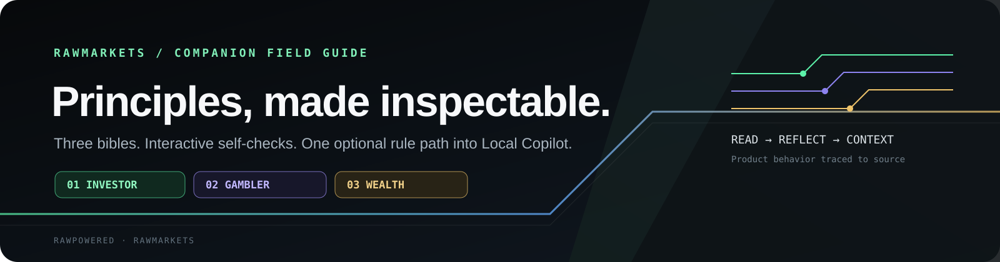
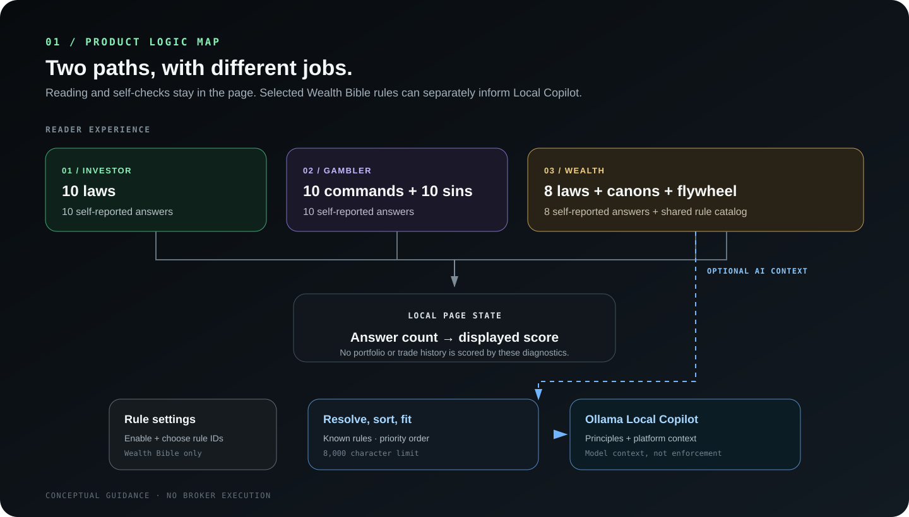
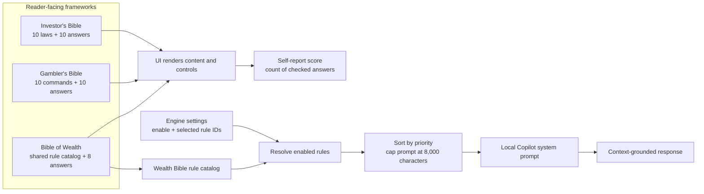

  

   

  **Three reading frameworks. One visible decision path.**

  [How it works](#how-it-works) · [Investor's Bible](docs/INVESTORS-BIBLE.md) · [Gambler's Bible](docs/GAMBLERS-BIBLE.md) · [Bible of Wealth](docs/BIBLE-OF-WEALTH.md) · [Engineering flow](docs/ENGINEERING-FLOW.md)

RawMarkets includes three principle-led reading experiences. This companion project explains what each one teaches, what its interactive controls calculate, and how a selected subset of Wealth Bible rules can shape the local copilot prompt.

  

## The three frameworks

| Framework | Purpose in the product | What the interface does |
| --- | --- | --- |
| **Investor's Bible** | Long-horizon capital habits, liquidity, diversification, costs, and emotional discipline. | Presents ten laws, lets readers pin laws, and scores ten self-reported answers. |
| **Gambler's Bible** | Risk-taking discipline, expected value, sizing concepts, exits, and behavioral failure modes. | Presents ten commandments and ten trading sins, then scores ten self-reported answers. |
| **Bible of Wealth** | Combines capital preservation and controlled risk into a single wealth architecture. | Presents eight laws, two canons, a five-step flywheel, allocation bands, and an eight-answer diagnostic. It also supplies the optional AI rule-space catalog. |

## How it works

The checklist result is the number of affirmative answers. It reports alignment with the prompts a reader selected. It is not a holdings analysis, a backtest, a probability estimate, or a validated measure of financial safety.

Only the **Bible of Wealth** rule catalog is wired into the Local Copilot prompt path. The Investor's and Gambler's diagnostic scores are displayed by their pages. The principles do not execute trades, place orders, or automatically change a portfolio.

## Direct code references

- [Investor's Bible page](https://github.com/RawPowered/RawMarkets/blob/main/src/components/InvestorsBible.tsx)
- [Gambler's Bible page](https://github.com/RawPowered/RawMarkets/blob/main/src/components/GamblersBible.tsx)
- [Bible of Wealth page](https://github.com/RawPowered/RawMarkets/blob/main/src/components/BibleOfWealth.tsx)
- [Shared Wealth Bible rule catalog](https://github.com/RawPowered/RawMarkets/blob/main/src/lib/wealthBibleRules.ts)
- [Rule selection and prompt construction](https://github.com/RawPowered/RawMarkets/blob/main/src/server/wealthBibleRuleSpace.ts)
- [Local Copilot prompt integration](https://github.com/RawPowered/RawMarkets/blob/main/src/server/ollamaChat.ts)
- [Rule-space controls](https://github.com/RawPowered/RawMarkets/blob/main/src/components/engine/WealthBibleRuleSpaceSettings.tsx)

## Review the companion guides

- [Investor's Bible: ten laws and the self-assessment](docs/INVESTORS-BIBLE.md)
- [Gambler's Bible: commandments, failure modes, and risk protocol](docs/GAMBLERS-BIBLE.md)
- [Bible of Wealth: synthesis, flywheel, and rule catalog](docs/BIBLE-OF-WEALTH.md)
- [Engineering flow: UI state, rule selection, prompt assembly, and limits](docs/ENGINEERING-FLOW.md)

## Scope and data boundaries

This repo is a documentation and diagram companion to the [RawMarkets application](https://github.com/RawPowered/RawMarkets). It contains no portfolio records, provider credentials, databases, or installer. The linked source repo has no license grant. No license is granted by this companion repo unless a maintainer adds one.

The principles and numeric prompts are educational product content. They do not establish a fiduciary relationship, provide individualized investment advice, or promise performance. Readers should verify assumptions and consider qualified financial, tax, and legal advice for their circumstances.
