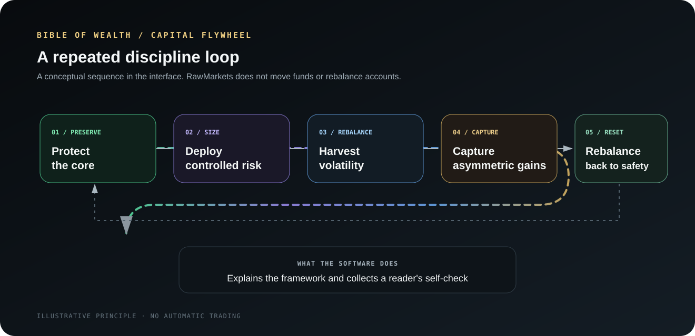

# Bible of Wealth

The Bible of Wealth is the product's synthesis page. It balances the Investor's preservation-first approach with the Gambler's controlled risk-taking approach for stock-market participation. It uses a shared rule catalog for its interface and optional Local Copilot context.

## Page structure

1. **Investor's Canon:** tangible utility and scarcity, barbell allocation, fractional Kelly, volatility harvesting, and disposition-effect control.
2. **Capital Flywheel:** protect the core, deploy controlled risk, harvest volatility, capture asymmetric gains, and rebalance back to safety.
3. **Gambler's Canon:** ergodic survival, utility gaps, reveal-driven reward loops, trader psychology, and reflexive feedback risk.
4. **Eight Laws:** survive first, size from edge, favor utility, keep a safe core, harvest volatility, avoid ruinous leverage, master psychology, and rebalance gains.
5. **Long-Horizon Capital Stack:** five target ranges for public equities, private equity and venture, productive land, collectibles and real assets, and liquidity.
6. **Wealth Architecture Adherence:** eight yes-or-no prompts scored from 0 to 8.

In that balance, the Gambler's quarter-Kelly cap belongs to its higher-variance canon. The Wealth Bible's Half-Kelly pillar is the moderated position within the stock-market synthesis. The page combines controlled risk with protection of the core and a return path to safety.

## What the capital flywheel depicts

  

The flywheel is a conceptual sequence in the interface. The app does not move money, rebalance accounts, or execute a brokerage order.

## Diagnostic behavior

The eight prompts are buttons. Selecting a prompt marks it affirmative. **Calculate index** counts the selected answers. The page shows:

- **6 to 8:** Flywheel aligned.
- **4 to 5:** Mixed.
- **0 to 3:** At risk.

The result reflects the reader's own answers only. The page does not inspect portfolio data to calculate the score.

## Allocation bands

| Capital group | Range displayed |
| --- | ---: |
| Public equities | 40 to 50% |
| Private equity and venture | 10 to 20% |
| Productive land | 10 to 20% |
| Collectibles and real assets | 5 to 15% |
| Liquidity reserve | 10 to 20% |

Each range is rendered as written in the shared rule catalog. The page does not choose a point inside each range or enforce a total of 100%. The combined minimums equal 75%; the maximums equal 125%.

## Rule Space for Local Copilot

The shared catalog also feeds one optional AI path:

- The control panel can enable or disable Wealth Bible context and select individual rules or whole categories.
- An empty explicit selection falls back to the default rule IDs while the feature is enabled.
- The server resolves selected IDs against the catalog and sorts them by priority.
- The prompt builder includes complete rules until its 8,000-character limit, then adds a note that lower-priority rules were omitted.
- The resulting text is included in the system prompt for the local Ollama Copilot before the platform context.

The rule space provides model context. It is not a deterministic portfolio calculation or a model safety guarantee. It only applies to the Local Copilot prompt path shown in the source.

## Code

- [Bible of Wealth page](https://github.com/RawPowered/RawMarkets/blob/main/src/components/BibleOfWealth.tsx)
- [Rule catalog and display adapters](https://github.com/RawPowered/RawMarkets/blob/main/src/lib/wealthBibleRules.ts)
- [Selection and prompt builder](https://github.com/RawPowered/RawMarkets/blob/main/src/server/wealthBibleRuleSpace.ts)
- [Settings control](https://github.com/RawPowered/RawMarkets/blob/main/src/components/engine/WealthBibleRuleSpaceSettings.tsx)
- [Local Copilot system prompt](https://github.com/RawPowered/RawMarkets/blob/main/src/server/ollamaChat.ts)

## Interpretation limits

The displayed framework combines heuristics and educational concepts. It has not been validated as an investment strategy. Capital ranges may conflict in combination, and Kelly calculations are only as reliable as their inputs. Treat labels, prompts, and model responses as decision-support content for independent review.
