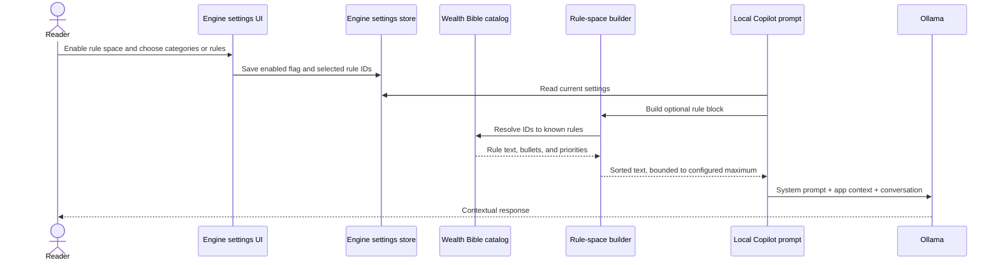

# Engineering flow

This page separates the visible reading experience from the code path that supplies selected principles to Local Copilot.

## Product paths

  

### A. Self-assessment path

The three pages keep checklist answers, scores, and pin state in React component state. A reader toggles answers, then the page counts `true` values and renders a summary. The scores do not come from portfolio history or a market-data calculation, and the current page implementations do not persist the answers.

For example, six checked responses in a ten-item diagnostic render a 60% index. That is a count, not a calibrated probability of survival or success.

### B. Local Copilot rule path

Implementation details:

- Settings include `aiWealthBibleEnabled` and `aiWealthBibleRuleIds`.
- When disabled, the rule builder returns an empty string.
- When enabled with an empty ID list, the resolver uses the default rule IDs.
- Selected IDs resolve through the catalog. Unknown IDs are skipped.
- Rules sort by ascending `priority`, then by ID.
- The prompt builder defaults to 8,000 characters and appends an omission note if lower-priority rules do not fit.
- `ollamaChat.ts` inserts the rule block before platform context in the system message.

## Source map

| Concern | Source |
| --- | --- |
| Principle page composition and local diagnostic state | [`src/components/BibleOfWealth.tsx`](https://github.com/RawPowered/RawMarkets/blob/main/src/components/BibleOfWealth.tsx) |
| Shared rule categories, IDs, priorities, and display models | [`src/lib/wealthBibleRules.ts`](https://github.com/RawPowered/RawMarkets/blob/main/src/lib/wealthBibleRules.ts) |
| Rule enable/selection controls | [`src/components/engine/WealthBibleRuleSpaceSettings.tsx`](https://github.com/RawPowered/RawMarkets/blob/main/src/components/engine/WealthBibleRuleSpaceSettings.tsx) |
| Prompt resolution, priority ordering, and truncation | [`src/server/wealthBibleRuleSpace.ts`](https://github.com/RawPowered/RawMarkets/blob/main/src/server/wealthBibleRuleSpace.ts) |
| System prompt composition and Ollama request | [`src/server/ollamaChat.ts`](https://github.com/RawPowered/RawMarkets/blob/main/src/server/ollamaChat.ts) |
| Engine settings schema and defaults | [`src/server/db.ts`](https://github.com/RawPowered/RawMarkets/blob/main/src/server/db.ts) |

## Design boundaries

- The Investor's and Gambler's diagnostic responses are local page state. The current code does not send them to Local Copilot.
- The Wealth Bible rule block is text context for a model. It does not enforce policy on its own.
- An AI response can omit or misinterpret rules. Users should inspect the output and the data it used.
- The product has no brokerage order path in these pages. Nothing here submits, edits, or cancels trades.
- The page labels and risk bands are user-interface copy. They are not clinical, actuarial, or audited measurements.

## Framework distinction and editorial seam

The separate Kelly fractions represent the frameworks' intended risk postures. The Gambler's Bible presents a quarter-Kelly cap for its higher-variance approach. The Wealth Bible uses Half Kelly within a stock-market balance of risk deployment and capital preservation. These are not one global sizing rule.

One same-page wording difference remains in the Investor's Bible:

The Investor's Bible Law VII says five years, while its diagnostic says three or more years. The source contains both thresholds. A future copy pass can align that diagnostic with the law.
